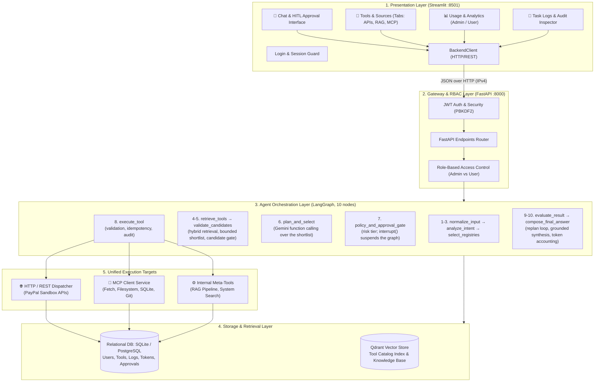
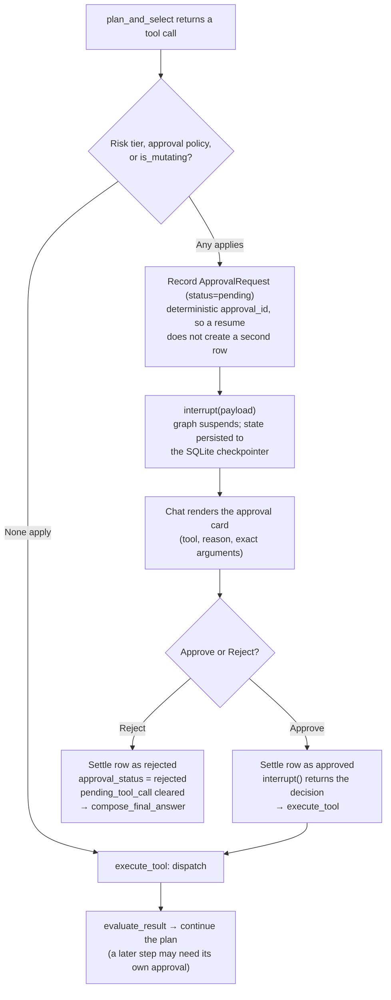
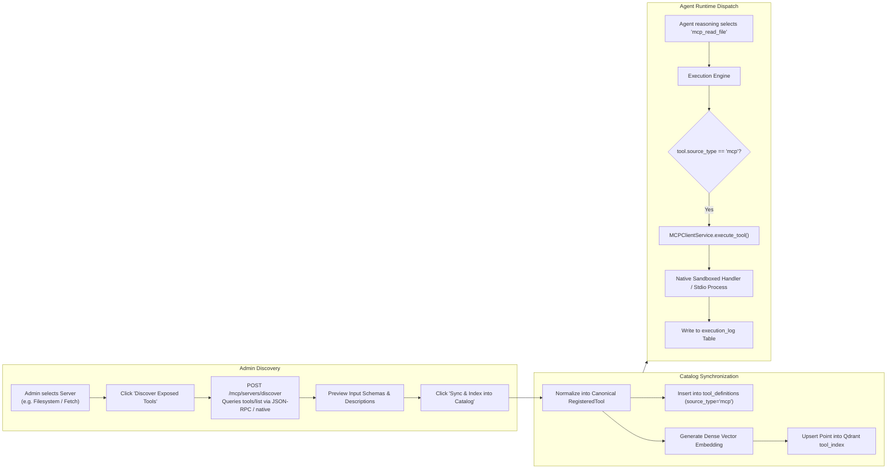
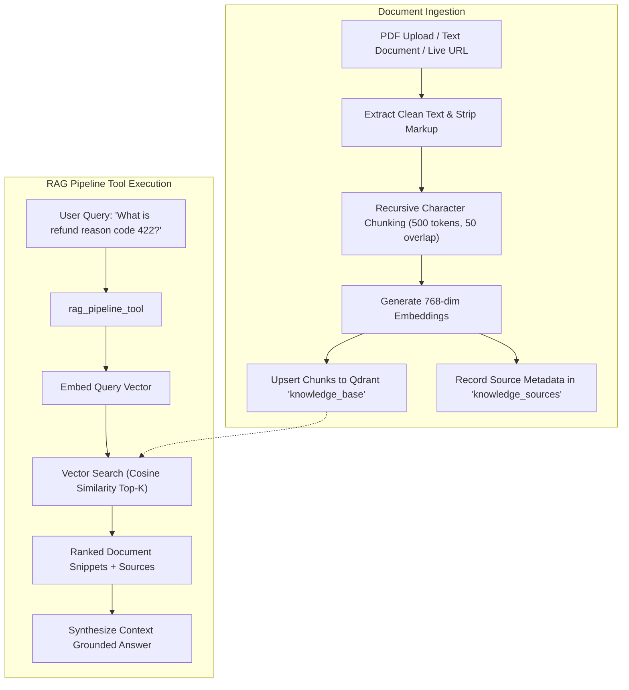

# Datazoic Agentic Platform: System Architecture & Workflow Specification

This document provides a complete technical reference for the current system architecture, component boundaries, execution graphs, and data flows. Use this blueprint to evaluate and implement your planned architectural and workflow changes.

---

## 1. System Architecture Overview

The system is organized into a **decoupled, multi-layered architecture** separating the presentation interface, API gateway, agentic orchestration, tool discovery, and execution targets:



---

## 2. Core Technological Components

| Layer | Technology | Primary Function |
| :--- | :--- | :--- |
| **Presentation** | Streamlit 1.35+ | Multi-screen responsive UI, reactive state management, JSON payload rendering. |
| **Gateway** | FastAPI + Uvicorn | Async ASGI server, JWT bearer authentication, schema validation, CORS. |
| **Orchestration** | LangGraph StateGraph | Cyclic graph execution, human-in-the-loop state pausing, DAG parameter piping. |
| **LLM Reasoning** | Google GenAI SDK | Multi-turn planning, function-call generation, usage metadata tracking. |
| **Vector DB** | Qdrant (in-memory / client) | Dense semantic search (768-dim embeddings) for tools and knowledge chunks. |
| **Relational DB** | SQLite (`aiosqlite`) / PostgreSQL | Persisted accounts, technical schemas, audit logs, and token ledgers. |
| **Protocol Layer** | Model Context Protocol (MCP) | Zero-dependency native & stdio bridge for Filesystem, Fetch, Git, and DB tools. |

---

## 3. End-to-End Workflow Processes

### Workflow 1: Natural Language Execution & Orchestration
This is the central execution path from user prompt to API execution:

```mermaid
sequenceDiagram
    autonumber
    actor User
    participant UI as Streamlit Chat
    participant API as FastAPI Gateway
    participant LG as LangGraph Workflow
    participant Qdrant as Qdrant Vector Store
    participant Gemini as Gemini LLM
    participant Router as Execution Router
    participant Target as Target API / MCP
    participant DB as SQLite Audit Ledger

    User->>UI: Enters: "Send invoice for $50 to client@example.com"
    UI->>API: POST /chat (prompt, conversation_id, bearer_token)
    API->>DB: Load recent turns of this session (conversation memory)
    API->>LG: ainvoke(AgentState) on a per-run checkpoint thread

    LG->>LG: 1-3. Normalize, classify intent, extract entities, scope namespaces
    LG->>Qdrant: 4. retrieve_tools: dense vector search (domain-filtered)
    LG->>DB: 4. retrieve_tools: sparse keyword scoring over catalog metadata
    Qdrant-->>LG: Ranked candidates
    Note over LG: RRF fusion + dependency expansion + 2 pinned meta-tools<br/>→ bounded shortlist (~10 schemas)
    LG->>LG: 5. validate_candidates: mandatory fields present?

    LG->>Gemini: 6. plan_and_select: query + shortlist as function declarations
    Gemini-->>LG: Function call: paypal_send_invoice(invoice_id, recipient_email, ...)
    Note over LG: A name outside the shortlist is discarded here

    LG->>LG: 7. policy_and_approval_gate: risk tier / mutating?
    LG->>DB: Record ApprovalRequest (status=pending)
    Note over LG: interrupt() suspends the graph INSIDE this node;<br/>state is persisted by the checkpointer
    LG-->>API: __interrupt__ with the approval payload
    API-->>UI: status=waiting_approval + pending_approval
    UI-->>User: Approval card (tool, reason, exact arguments)

    User->>UI: Clicks Approve
    UI->>API: POST /runs/{run_id}/approval (action=approve)
    API->>LG: ainvoke(Command(resume={action})) on the same thread
    Note over LG: Execution continues from inside the gate

    LG->>Router: 8. execute_tool: validate args, attach idempotency key
    Router->>Target: HTTP POST /v2/invoicing/invoices/{invoice_id}/send
    Target-->>Router: HTTP 202 Accepted
    Router->>DB: Write ExecutionLog (user_id, request_id, tool, status, latency)

    LG->>LG: 9. evaluate_result: goal met, or another step needed?
    Note over LG: If more work remains, control returns to plan_and_select<br/>with every completed step's results in context
    LG->>Gemini: 10. compose_final_answer: synthesise from the execution trace
    Gemini-->>LG: Grounded reply + usage_metadata token counts
    LG->>DB: Record TokenUsage (input, output, total, model)
    LG->>DB: Update AgentRun (status, tools_used, trace, final_response)
    API-->>UI: JSON response + timeline + trace + token usage
    UI-->>User: Reply, the stages that actually ran, and the trace
```

---

### Workflow 2: Human-in-the-Loop (HITL) Approval Workflow

An action is gated when its risk tier is `external_write`, `financial` or `destructive`, when its
approval policy demands confirmation, or when it is marked mutating. The reason shown to the user
names the condition that actually triggered.

The gate calls LangGraph's `interrupt()`, which **suspends the graph inside the node** rather than
ending the turn. Resuming continues the original flow, so remaining plan steps are not lost.



**Guarantees**

| Property | How |
| :--- | :--- |
| Survives a restart | Checkpoints are SQLite-backed; a pending run is resumable after the process dies |
| Cannot be disturbed | One checkpoint thread per run, so the next message in the conversation does not touch it |
| Owner-gated | Only the run's owner, or an administrator, may decide it (`403` otherwise) |
| Single-use | A settled run returns `409` instead of executing again |
| Fails safe | An unrecoverable checkpoint marks the run expired and asks the user to re-send, rather than dispatching silently |

---

### Workflow 3: Model Context Protocol (MCP) Integration Flow
How the platform dynamically imports and executes external MCP capabilities:



---

### Workflow 4: RAG Ingestion and Knowledge Retrieval
How technical API documentation, PDFs, and URLs are embedded and queried:



---

## 4. Canonical Data Model Reference

The platform relies on 9 database tables:

| Model Name | Table Name | Key Attributes | Purpose |
| :--- | :--- | :--- | :--- |
| **`User`** | `users` | `user_id`, `email`, `password_hash`, `role` (`admin`/`user`), `is_active` | RBAC authentication and session ownership. |
| **`ToolDefinition`** | `tool_definitions` | `tool_id`, `name`, `category`, `method`, `endpoint_path`, `source_type`, `mcp_server_name`, `request_body_schema`, `approval_required`, `status` | Canonical tool contract. Parameters persist by location (`path_params`, `query_params`, `request_body_schema`), with `tags` holding retrieval keywords and `dependencies` the prerequisite edges, so the full contract survives a restart. |
| **`MCPServerDefinition`**| `mcp_servers` | `server_id`, `name`, `display_name`, `server_type` (`builtin`/`stdio`), `command`, `args`, `is_active` | Configured open-source and native MCP servers. |
| **`KnowledgeSource`** | `knowledge_sources` | `source_id`, `name`, `source_type` (`file`/`url`), `chunk_count`, `created_at` | Tracks uploaded RAG documentation. |
| **`ExecutionLog`** | `execution_log` | `request_id`, `session_id`, `user_id`, `tool_name`, `status`, `input_args`, `response_payload`, `latency_ms` | Immutable audit ledger powering the **Task Logs** screen. |
| **`TokenUsage`** | `token_usage` | `request_id`, `user_id`, `model`, `input_tokens`, `output_tokens`, `total_tokens` | Per-user Gemini cost and consumption accounting. |
| **`ApprovalRequest`** | `approval_requests` | `approval_id`, `run_id`, `user_id`, `tool_name`, `input_args`, `status` (`pending`/`approved`/`rejected`/`expired`), `decided_by` | Human-in-the-loop decisions. `approval_id` is deterministic per step, so resuming does not create a duplicate row. |
| **`AgentRun`** | `agent_runs` | `run_id`, `user_id`, `session_id`, `query`, `status`, `approval_status`, `tools_used`, `execution_trace`, `final_response`, `duration_ms` | One row per turn. `final_response` is what makes conversation history replayable into later turns. |
| **`Conversation`** | `conversations` | `conversation_id`, `user_id`, `title`, `messages` | Conversation records. |

> [!NOTE]
> `agent_runs.run_id`, `token_usage.request_id` and `execution_log.request_id` all carry the same
> per-turn identifier. Joining on it is what lets a task be reported with its own token cost and
> its own tool-call rows, which is what the Usage and Logs screens do.

---

## 5. Key Architecture & Workflow Change Points

Where to extend the system, and what is already in place.

### 1. Agent Orchestration (LangGraph Layer)
- **Current state**: an explicit 10-node graph (`normalize_input` → `analyze_intent` →
  `select_registries` → `retrieve_tools` → `validate_candidates` → `plan_and_select` →
  `policy_and_approval_gate` → `execute_tool` → `evaluate_result` → `compose_final_answer`),
  compiled with a **SQLite checkpointer**. Multi-step work is model-driven: `evaluate_result`
  returns control to the planner with every completed step's results in context, and the loop
  ends when the model stops calling tools (bounded by `max_iterations`).
- **Possible changes**:
  - Specialised sub-agents per domain (`InvoicingAgent`, `DisputeAgent`), if domains diverge
    enough to need separate prompting strategies.
  - A reflection node that critiques a plan before execution, for high-risk actions.
  - Parallel execution of independent steps, which currently run sequentially.

### 2. Tool Retrieval & Discovery
- **Current state**: domain classification from keyword patterns → dense Qdrant search with a
  domain payload filter, alongside sparse keyword scoring → **Reciprocal Rank Fusion** →
  prerequisite dependency expansion → the two pinned meta-tools appended unconditionally. The
  domain filter is relaxed and the search repeated if it returns too little.
- **Possible changes**:
  - Replace the token-overlap sparse score with **BM25** proper, for better term weighting.
  - Add a **cross-encoder re-ranker** over the fused shortlist, which matters most where one
    domain holds many near-identical endpoints.
  - Use real embeddings for the knowledge base; it currently uses the deterministic fallback, so
    document retrieval does not generalise to synonyms.
  - Build a labelled query → expected-tool set and measure shortlist recall directly, separating
    retrieval quality from model quality.

### 3. Execution Router & Adapters
- **Current state**: a single `ExecutionEngine` branching on `source_type`
  (`http_api`, `mcp`, internal meta-tools), with parameter validation, idempotency headers on
  mutating calls, and an audit row per attempt including failures.
- **Possible changes**:
  - Extract into a Strategy/plugin pattern (`HttpExecutionAdapter`, `McpExecutionAdapter`,
    `InternalExecutionAdapter`).
  - Add a background job queue for long-running batch operations.
  - Add per-tool circuit breaking and retry policy driven by the existing `retry_config` column.

### 4. Observability
- **Current state**: a per-turn stage timeline surfaced in the chat screen, plus the relational
  audit tables. Token counts come from the SDK's `usage_metadata`.
- **Possible changes**:
  - Wire in **LangSmith** or an equivalent tracer. This is configuration rather than redesign,
    since the pipeline is already a checkpointed graph.
  - Emit metrics (per-stage latency, shortlist hit rate, approval rates) to a time-series store.

### 5. Frontend & Backend Transport
- **Current state**: synchronous HTTP from Streamlit via `BackendClient`. The chat screen renders
  the stage timeline the backend reports for each turn.
- **Possible changes**:
  - Server-Sent Events or WebSockets for token-by-token streaming and live stage updates during a
    turn, rather than after it.
  - Decouple the frontend entirely (for example a Next.js UI against the same API).

### 6. Persistence
- **Current state**: SQLAlchemy models with `create_all`, plus ad-hoc `ALTER TABLE` statements in
  `init_db` for columns added to an existing SQLite file.
- **Possible changes**:
  - Adopt **Alembic** before any deployment that must preserve data.
  - Delete a source's vectors alongside its metadata row, and add a reindex command.

---

## 6. Current File System Mapping

```
Agent_platform/
├── app/
│   ├── main.py                      # FastAPI app: endpoints, RBAC deps, startup seeding
│   ├── config.py                    # Pydantic Settings (.env loader)
│   ├── core/
│   │   ├── security.py              # PBKDF2 hashing, JWT issue/verify, role dependencies
│   │   ├── exceptions.py            # Typed application errors
│   │   └── telemetry.py             # Logging helpers
│   ├── db/
│   │   ├── models.py                # SQLAlchemy ORM models (9 tables)
│   │   ├── session.py               # Async engine, init_db, SQLite column auto-migration
│   │   └── vector_store.py          # Qdrant client + deterministic embedding fallback
│   ├── graph/
│   │   ├── state.py                 # AgentState TypedDict
│   │   ├── nodes.py                 # The 10 pipeline nodes + deterministic fallback planner
│   │   └── workflow.py              # StateGraph, checkpointer, run_agent / resume_agent
│   ├── meta_tools/
│   │   ├── rag_pipeline_tool.py     # Pinned meta-tool 1 (knowledge-base retrieval)
│   │   ├── system_search_tool.py    # Pinned meta-tool 2 (catalog + execution-log search)
│   │   ├── calculator_tool.py       # General-purpose tools (calculation, time) + definitions
│   │   └── email_tool.py            # Draft / send email (simulated without SMTP config)
│   ├── schemas/                     # Pydantic request/response models
│   │   └── agent.py, auth.py, chat.py, mcp.py, paypal.py, source.py, tool.py, usage.py
│   └── services/
│       ├── llm_service.py           # Gemini function calling, grounded synthesis, token counts
│       ├── tool_registry.py         # Dual-index catalog (relational contract + vector index)
│       ├── tool_retriever.py        # Two-stage hybrid retrieval, RRF, dependency expansion
│       ├── execution_engine.py      # Validation, idempotency, dispatch (mock/HTTP/MCP), audit
│       ├── ingestion.py             # Postman collection parsing into tool contracts
│       ├── document_service.py      # Document/URL ingestion, chunking, vector indexing
│       ├── mcp_client.py            # MCP discovery and stdio JSON-RPC bridge
│       └── token_usage_service.py   # Per-user token accounting and summaries
├── frontend/
│   ├── app.py                       # Streamlit navigation and screen router
│   ├── components/
│   │   ├── chat.py                  # Screen 1: chat, real stage timeline, approval cards
│   │   ├── login.py                 # Login with quick demo accounts
│   │   ├── sidebar.py               # User badge, screen selector, sample scenarios
│   │   ├── tool_catalog.py          # Screen 2a: catalog browse and admin registration
│   │   ├── tool_creation.py         # Screen 2a: tool creation form
│   │   ├── source_catalog.py        # Screen 2b: document and URL ingestion
│   │   ├── mcp_catalog.py           # Screen 2c: MCP servers and test workbench
│   │   ├── activity_table.py        # Shared per-task token and tool-call tables
│   │   ├── usage_dashboard.py       # Screen 3: personal usage, per-task tokens
│   │   ├── user_management.py       # Screen 3: admin directory and per-user drilldown
│   │   └── task_logs.py             # Screen 4: logs grouped by user, per-task tool tables
│   └── services/
│       └── backend_client.py        # HTTP client (target: 127.0.0.1:8000)
├── tests/
│   ├── unit/                        # Auth, permissions, retrieval, ingestion, meta-tools
│   │   └── test_llm_planner.py      # Planner contract against a stubbed Gemini SDK
│   ├── integration/
│   │   ├── test_paypal_flows.py     # End-to-end turns for the task's scenarios
│   │   └── test_approval_resume.py  # Suspend/resume, rejection, restart survival, memory
│   ├── evals/                       # Golden queries and eval runner
│   └── benchmarks/                  # Catalog generator and benchmark runner
├── docs/                            # Generated PDFs + the assignment brief (task.txt)
├── build_docs.py                    # Regenerates the docs/ PDF set
├── sandbox_storage/                 # Sandboxed directory for the Filesystem MCP tools
├── requirements.txt                 # Dependencies
├── docker-compose.yml               # Optional local PostgreSQL + Qdrant
├── run_application.bat              # Windows launcher (venv, install, both processes)
└── README.md                        # Entry point and quickstart
```


