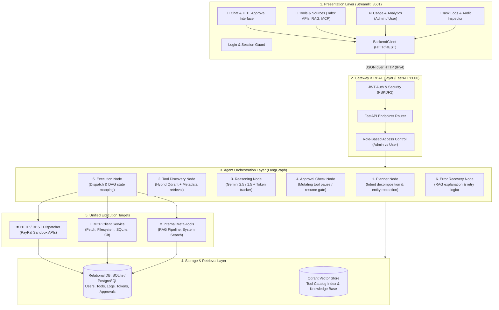
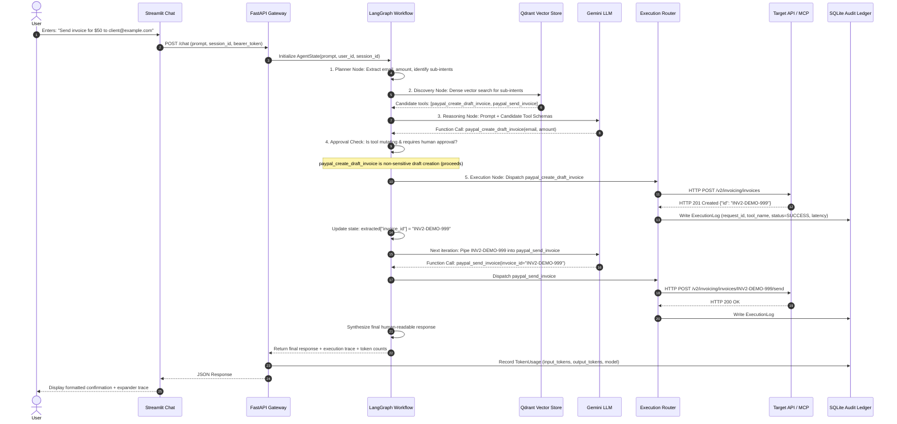
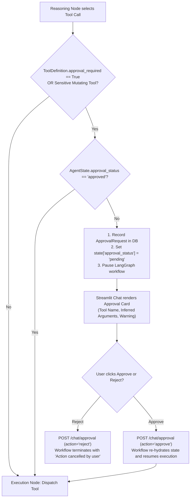
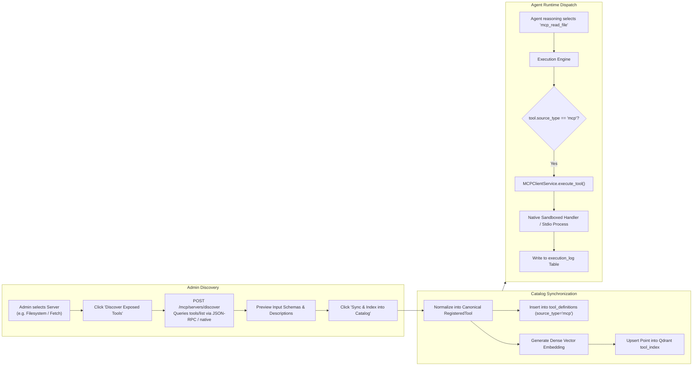
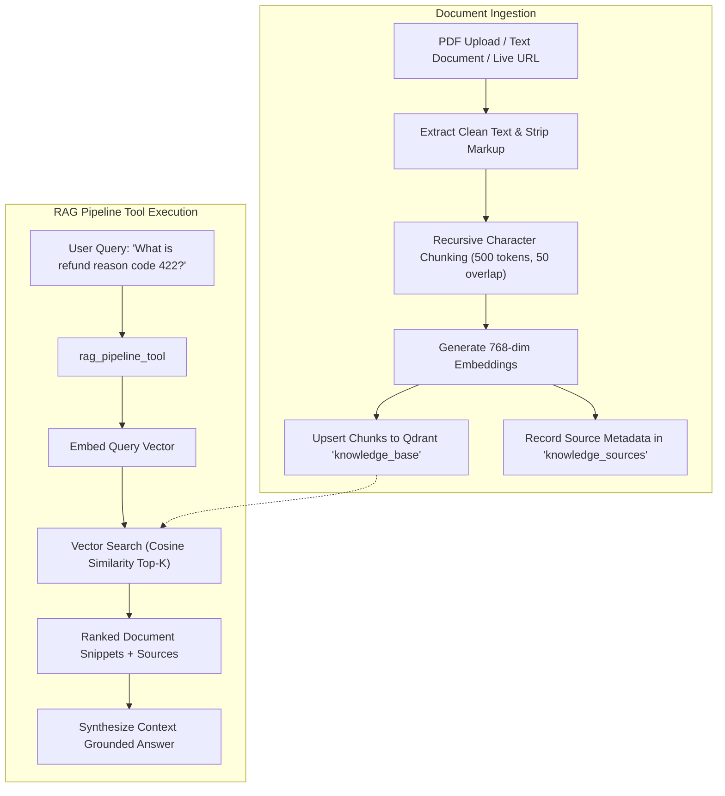

# Datazoic Agentic Platform: System Architecture & Workflow Specification

This document provides a complete technical reference for the current system architecture, component boundaries, execution graphs, and data flows. Use this blueprint to evaluate and implement your planned architectural and workflow changes.

---

## 1. System Architecture Overview

The system is organized into a **decoupled, multi-layered architecture** separating the presentation interface, API gateway, agentic orchestration, tool discovery, and execution targets:



---

## 2. Core Technological Components

| Layer | Technology | Primary Function |
| :--- | :--- | :--- |
| **Presentation** | Streamlit 1.35+ | Multi-screen responsive UI, reactive state management, JSON payload rendering. |
| **Gateway** | FastAPI + Uvicorn | Async ASGI server, JWT bearer authentication, schema validation, CORS. |
| **Orchestration** | LangGraph StateGraph | Cyclic graph execution, human-in-the-loop state pausing, DAG parameter piping. |
| **LLM Reasoning** | Google GenAI SDK | Multi-turn planning, function-call generation, usage metadata tracking. |
| **Vector DB** | Qdrant (in-memory / client) | Dense semantic search (768-dim embeddings) for tools and knowledge chunks. |
| **Relational DB** | SQLite (`aiosqlite`) / PostgreSQL | Persisted accounts, technical schemas, audit logs, and token ledgers. |
| **Protocol Layer** | Model Context Protocol (MCP) | Zero-dependency native & stdio bridge for Filesystem, Fetch, Git, and DB tools. |

---

## 3. End-to-End Workflow Processes

### Workflow 1: Natural Language Execution & Orchestration
This is the central execution path from user prompt to API execution:



---

### Workflow 2: Human-in-the-Loop (HITL) Approval Workflow
When an agent selects a sensitive or mutating tool (e.g. issuing a high-value refund or deleting a resource):



---

### Workflow 3: Model Context Protocol (MCP) Integration Flow
How the platform dynamically imports and executes external MCP capabilities:



---

### Workflow 4: RAG Ingestion and Knowledge Retrieval
How technical API documentation, PDFs, and URLs are embedded and queried:



---

## 4. Canonical Data Model Reference

The platform relies on 7 primary database tables:

| Model Name | Table Name | Key Attributes | Purpose |
| :--- | :--- | :--- | :--- |
| **`User`** | `users` | `user_id`, `email`, `password_hash`, `role` (`admin`/`user`), `is_active` | RBAC authentication and session ownership. |
| **`ToolDefinition`** | `tool_definitions` | `tool_id`, `name`, `category`, `method`, `endpoint_path`, `source_type`, `mcp_server_name`, `request_body_schema`, `approval_required`, `status` | Canonical technical registry for all 66+ tools. |
| **`MCPServerDefinition`**| `mcp_servers` | `server_id`, `name`, `display_name`, `server_type` (`builtin`/`stdio`), `command`, `args`, `is_active` | Configured open-source and native MCP servers. |
| **`KnowledgeSource`** | `knowledge_sources` | `source_id`, `name`, `source_type` (`file`/`url`), `chunk_count`, `created_at` | Tracks uploaded RAG documentation. |
| **`ExecutionLog`** | `execution_log` | `request_id`, `session_id`, `user_id`, `tool_name`, `status`, `input_args`, `response_payload`, `latency_ms` | Immutable audit ledger powering the **Task Logs** screen. |
| **`TokenUsage`** | `token_usage` | `request_id`, `user_id`, `model`, `input_tokens`, `output_tokens`, `total_tokens` | Per-user Gemini cost and consumption accounting. |
| **`ApprovalRequest`** | `approval_requests` | `run_id`, `user_id`, `tool_name`, `arguments`, `status` (`pending`/`approved`/`rejected`) | Human-in-the-loop pause/resume control. |

---

## 5. Key Architecture & Workflow Change Points

Use this section to identify where you can modify the current system design:

### 1. Agent Orchestration (LangGraph Layer)
- **Current State**: A 6-node linear graph with cyclic reasoning loops (`planner` ➔ `tool_discovery` ➔ `reasoning` ➔ `approval_check` ➔ `execution` ➔ `recovery`).
- **Potential Changes**:
  - Add a **Multi-Agent Architecture** (e.g., specialized sub-agents: `InvoicingAgent`, `DisputeAgent`, `MCPDiagnosticsAgent`).
  - Add **Memory Checkpointing** (using SQLite or Postgres checkpoints instead of in-memory LangGraph state).
  - Replace the planner node with a full **ReAct** (Reason + Act) loop.

### 2. Tool Retrieval & Discovery
- **Current State**: Dual search (intent keywords classify domain ➔ Qdrant retrieves top-K candidates ➔ always attaches 2 meta-tools).
- **Potential Changes**:
  - Implement dynamic sparse BM25 scoring alongside dense vector search (true hybrid RRF).
  - Introduce dynamic tool hierarchy / namespaces (e.g. grouping tools under modules to scale beyond 1,000+ tools without context window overflow).

### 3. Execution Router & Adapters
- **Current State**: Single `ExecutionEngine` class that branches on `source_type` (`http_api`, `mcp`, `internal`).
- **Potential Changes**:
  - Extract into dedicated Strategy/Plugin pattern (`HttpExecutionAdapter`, `McpExecutionAdapter`, `InternalExecutionAdapter`).
  - Introduce async background job queues (e.g. Celery / Redis / BackgroundTasks) for long-running batch API operations.

### 4. Frontend & Backend Transport
- **Current State**: Synchronous HTTP POST requests from Streamlit via `BackendClient`.
- **Potential Changes**:
  - Implement Server-Sent Events (SSE) or WebSockets on `GET /chat/stream` for real-time word-by-word token streaming.
  - Decouple frontend completely (e.g. Next.js / React UI talking to the same FastAPI backend).

---

## 6. Current File System Mapping

```
application_agent/
├── app/
│   ├── main.py                     # FastAPI entry point, lifespan, routes & DI
│   ├── config.py                   # Pydantic Settings (.env loader)
│   ├── core/
│   │   └── security.py             # Salted PBKDF2 hashing & JWT tokens
│   ├── db/
│   │   ├── models.py               # SQLAlchemy ORM models
│   │   ├── session.py              # Async SQLite engine & auto-migration
│   │   └── vector_store.py         # Qdrant client (query_points + deterministic fallback)
│   ├── graph/
│   │   ├── state.py                # AgentState TypedDict
│   │   ├── nodes.py                # Planner, Discovery, Reasoning, Approval, Execution
│   │   └── workflow.py             # LangGraph StateGraph builder & runner
│   ├── meta_tools/
│   │   ├── rag_pipeline_tool.py    # Pinned Meta-Tool 1 (Documentation RAG)
│   │   └── system_search_tool.py  # Pinned Meta-Tool 2 (Capabilities & Audit Logs)
│   ├── schemas/
│   │   ├── auth.py, chat.py, mcp.py, tool.py, usage.py
│   └── services/
│       ├── execution_engine.py     # Unified Execution Router & audit logger
│       ├── mcp_client.py           # Native & Stdio MCP protocol manager
│       ├── tool_registry.py        # SQL + Qdrant tool catalog manager
│       ├── tool_retriever.py       # Two-stage intent classifier & vector search
│       └── token_usage_service.py  # User-level token accounting
├── frontend/
│   ├── app.py                      # Streamlit navigation & screen router
│   ├── components/
│   │   ├── chat.py                 # Chat UI with execution trace & HITL cards
│   │   ├── login.py                # Login screen with quick demo accounts
│   │   ├── sidebar.py              # User badge, screen radio, test scenarios
│   │   ├── tool_catalog.py         # Tab A: API Tools catalog & management
│   │   ├── source_catalog.py       # Tab B: Document RAG ingestion
│   │   ├── mcp_catalog.py          # Tab C: MCP servers & direct test workbench
│   │   ├── usage_dashboard.py      # User personal token statistics
│   │   ├── user_management.py      # Admin system-wide usage drilldown
│   │   └── task_logs.py            # Task Logs audit inspector with KPIs
│   └── services/
│       └── backend_client.py       # Frontend HTTP client (target: 127.0.0.1:8000)
├── sandbox_storage/                # Sandboxed directory for Filesystem MCP tools
├── requirements.txt                # Pinned dependencies
├── start.bat                       # Root batch launcher
└── run_application.bat             # Dual-window launcher (10s wait + health check)
```

