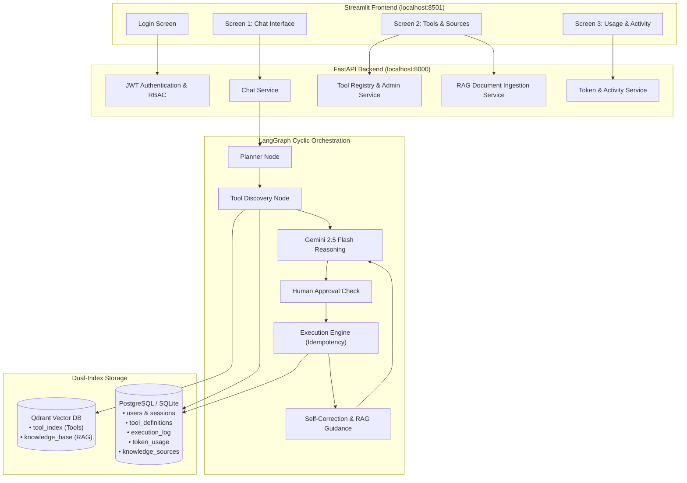

# Datazoic Agentic System

### Local Agentic API Orchestration Platform (50 to 1,000+ Tools)

Production-grade agentic architecture built for the **Datazoic AI Engineer Assessment**. It solves the degradation of LLMs under massive tool counts through a **two-stage hybrid tool discovery pipeline**, **cyclic LangGraph state machine orchestration**, **role-based access control (Admin & Normal User)**, **Gemini token-usage tracking**, and two pinned meta-tools (**RAG Pipeline Tool** and **System Search Tool**).

---

## 1. System Architecture Overview



---

## 2. Authentication & Local Demo Accounts

The system bootstraps two local accounts upon initial startup. Passwords are encrypted using salted **PBKDF2-HMAC-SHA256** hashes stored in the database.

| Role | Email | Password | Permissions |
| :--- | :--- | :--- | :--- |
| **Administrator** | `admin@examplemail.com` | `admin@123` | Full access: Chat, tool creation (10 sections), status toggling, document ingestion, all users' token usage & execution logs. |
| **Normal User** | `user@examplemail.com` | `user@123` | Restricted access: Chat, browse active tools & docs, personal execution history and personal token usage only. |

> [!IMPORTANT]
> Role-Based Access Control (RBAC) is enforced at every FastAPI backend endpoint (e.g. all `/admin/*` routes require `role == "admin"`). Normal users cannot call administrative endpoints or inspect another user's activity.

---

## 3. Frontend: Three Primary Screens

### Screen 1 — Chat Interface
- Multi-step execution progress indicator (`Identifying intent` $\rightarrow$ `Finding tools` $\rightarrow$ `Validating` $\rightarrow$ `Approval Check` $\rightarrow$ `Executing` $\rightarrow$ `Completed`).
- Approval workflow: Mutating or sensitive actions pause and prompt for confirmation with **Approve** and **Reject** buttons.
- Document citations retrieved by the RAG Pipeline Tool.
- User-level execution trace inspector.

### Screen 2 — Tools & Sources
- **Tab A (Registered Tools)**:
  - Browse tools with search and filtering by Category, HTTP Method, and Status.
  - **Administrator Tool Creation Form (10 Sections)**:
    1. Basic Information (name, display name, category, service, version, status)
    2. API Configuration (REST, method, base URL, endpoint path, content type, timeout)
    3. Path Parameters
    4. Query Parameters
    5. Headers
    6. Request Body JSON Schema
    7. Response Schema
    8. Execution Behavior (is_mutating, approval_required, permitted_roles, retries)
    9. Dependencies DAG (prerequisite tool mapping: `create_draft_invoice` $\rightarrow$ `send_invoice`)
    10. Schema Validation & Mock Test Execution
- **Tab B (Documents & Sources)**:
  - Browse indexed documentation and guides.
  - Administrator upload of Text/Markdown and Web Documentation URLs with automated chunking and Qdrant vectorization.

### Screen 3 — Usage & Activity
- **Normal User View**: Personal dashboard showing Total Tasks, Successful/Failed requests, Gemini Prompt/Output Tokens, and execution audit history.
- **Administrator View**: Platform KPI metrics and registered user directory with 4-section drilldown:
  1. *User Overview*: Email, role, status, creation date, total tasks.
  2. *Execution History*: Request ID, query, latency, and full trace.
  3. *Token Usage*: Model breakdown, prompt tokens, candidate tokens.
  4. *Tools & Sources Used*: Dispatched endpoints and retrieved knowledge sources.

---

## 4. The Two Pinned Meta-Tools

1. **RAG Pipeline Tool (`meta_tools/rag_pipeline_tool.py`)**:
   - Pinned tool permanently available to the agent.
   - Searches `knowledge_base` collection in Qdrant containing PayPal error code guides (e.g. `422 UNPROCESSABLE_ENTITY`, `CURRENCY_NOT_ALLOWED`), ISO currencies, and refund reason codes (`BUYER_COMPLAINT`, `SELLER_FAULT`, `RETURN`).
2. **System Search Tool (`meta_tools/system_search_tool.py`)**:
   - `scope="capabilities"`: Searches relational tool catalog metadata.
   - `scope="execution_logs"`: Searches relational execution audit logs.

---

## 5. Token Usage Tracking

The system extracts actual token usage metadata returned by the Google Gen AI SDK (`usage_metadata.prompt_token_count` and `candidates_token_count`) and stores records per-user and per-request in the `token_usage` table. External PayPal Sandbox API calls are tracked separately and do not consume LLM tokens.

---

## 6. Local Quickstart

### Prerequisites
- Python 3.10+
- (Optional) Docker for running local PostgreSQL & Qdrant; otherwise SQLite and in-memory Qdrant run with zero external setup.

### 1. Start the FastAPI Backend
```bash
uvicorn app.main:app --port 8000 --reload
```
On startup, the system automatically initializes tables, bootstraps the demo admin and user accounts, and seeds the 50+ PayPal API collection.

### 2. Start the Streamlit UI
In a separate terminal:
```bash
streamlit run frontend/app.py
```
Open [http://localhost:8501](http://localhost:8501) in your browser:
- Log in as **Administrator** (`admin@examplemail.com` / `admin@123`) to access tool creation and multi-user analytics.
- Log in as **Normal User** (`user@examplemail.com` / `user@123`) to test user isolation and restricted permissions.
