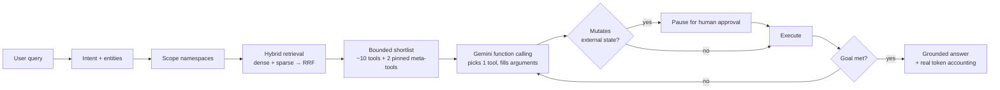

# Datazoic Agentic System

### Chat-driven API orchestration that stays accurate from 50 tools to 1,000+

An LLM given a handful of tools picks between them reliably. The same model given hundreds degrades: it picks semantic neighbours, borrows parameter names across schemas, and pays for a context window full of irrelevant definitions. The constraint is the size of the choice set — so this platform makes catalog size irrelevant to what the model sees on any single turn.

Built for the **Datazoic AI Engineer assessment** ([`docs/task.txt`](docs/task.txt)).

---

## 1. How it works



The catalog may hold any number of tools. Retrieval narrows it before the model is involved, and **only the shortlist is ever offered** — so the prompt stays the same size whether 60 tools are registered or 6,000.

Three constraints are enforced in code rather than requested in the prompt:

- **The shortlist is a hard boundary.** A tool name outside the candidate set is discarded before it can reach the execution engine.
- **One tool per turn.** Sequences emerge from the loop, not from a plan the model commits to up front — so a failed step can be retried with corrected arguments.
- **Missing arguments are asked for, not invented.** A required parameter that cannot be grounded in the request or a prior result produces a question, not a guess.

---

## 2. Quickstart

```bash
python -m venv .venv
.venv\Scripts\activate            # Windows
source .venv/bin/activate         # macOS / Linux
pip install -r requirements.txt
cp .env.example .env

uvicorn app.main:app --port 8000 --reload     # terminal 1
streamlit run frontend/app.py                 # terminal 2
```

On Windows, `run_application.bat` does all of the above. Then open **http://localhost:8501** (API docs at **http://127.0.0.1:8000/docs**).

First start creates the database, seeds the demo accounts, and populates the catalog with the PayPal collection, general-purpose tools, the two pinned meta-tools, and the built-in MCP tools.

> **It runs with no API key.** Every external dependency has a fallback, so the platform is fully demonstrable offline. Set `GEMINI_API_KEY` in `.env` to exercise the designed reasoning path — see [Degraded operation](#5-degraded-operation).

| Role | Email | Password | Access |
| :--- | :--- | :--- | :--- |
| Administrator | `admin@examplemail.com` | `admin@123` | Everything: chat, tool creation, document ingestion, every user's activity |
| Standard user | `user@examplemail.com` | `user@123` | Chat, browse active tools and documents, only their own activity |

> [!WARNING]
> These are seeded development credentials. Change them, and `JWT_SECRET_KEY`, before exposing the platform to anyone else. RBAC is enforced at every endpoint — `/admin/*` routes require the administrator role, and a normal user cannot read another user's runs, logs or token records.

---

## 3. Try it

| Ask | What happens |
| :--- | :--- |
| `What tools are available for managing invoices?` | System Search returns matching catalog entries |
| `What are the valid refund reason codes?` | RAG retrieves from the knowledge base and cites the document |
| `What was my total sales volume last month?` | Retrieves the transaction report, reports only the figures returned |
| `Is there a dispute open from user_123?` | Lists disputes, since no dispute identifier was supplied |
| `Send an invoice for $50 to client@example.com` | **Pauses for confirmation** — sending mutates external state |
| `What is the status of my last request?` | System Search returns your own recent executions |

---

## 4. The four screens

**Chat** — natural language in, with the pipeline stages that *actually ran* for your turn (not a fixed script), the tools executed, the tokens consumed, and the full execution trace. Actions that change external state pause and show the exact arguments that would be sent, with **Approve** / **Reject**.

**Tools & Sources** — browse and filter the catalog; administrators register tools through a form covering API configuration, path/query/header parameters, request and response schemas, execution behaviour, prerequisite dependencies, and schema validation with a mock test run. Documents (PDF, TXT, MD, CSV, JSON), documentation URLs or pasted text are chunked, embedded and indexed so the RAG tool can answer from them. MCP servers can be discovered and indexed into the same catalog.

**Usage** — per-task token accounting: what was asked, whether it succeeded, and the prompt/output/total tokens for *that task*. Administrators get platform totals plus a user directory with the same per-task table per account.

**Logs** — administrators pick a user and expand them to see that user's tasks, each with its tool calls in a table (tool, status, latency, timestamp) and an inspector for arguments and response payloads. Failed calls are included — it's an audit trail, not a success feed.

---

## 5. Degraded operation

| Dependency | Fallback when unavailable |
| :--- | :--- |
| Gemini (reasoning) | Deterministic rule-based planner and template responses |
| Gemini (embeddings) | Local deterministic hash embedding |
| Qdrant server | In-memory client |
| PostgreSQL | SQLite via `aiosqlite` |
| PayPal sandbox | Mock dispatch with realistic response shapes |
| SQLite checkpointer | In-memory checkpointer (approvals then don't survive a restart; this is logged) |

The pipeline, retrieval, governance and audit trail behave identically in fallback mode — only argument inference is weaker. The fallback planner recognises **only the intents encoded in its rules**; it exists so the system can be evaluated without a key, not as an equivalent substitute for the model.

---

## 6. Human approval, done properly

The policy gate calls LangGraph's `interrupt()`, which suspends the graph *inside the node* and persists its state. Approving **resumes the same run** from that point and continues through evaluation and any remaining plan steps.

```
POST /chat                → status=waiting_approval, pending_approval={...}
                            nothing dispatched; an approval row is pending
POST /runs/{id}/approval  → resumes the graph with the decision
   action=approve           execute → evaluate → remaining steps → answer
   action=reject            cancelled, nothing dispatched, reason recorded
```

Checkpoints are SQLite-backed, so **a run awaiting a human survives a process restart**. Each run gets its own checkpoint thread, so a suspended run can't be disturbed by the next message in the same conversation. Only the run's owner or an administrator may decide an approval, and a decision is single-use (a settled run returns `409`).

---

## 7. The two pinned meta-tools

Both are registered in the catalog and pinned into **every** shortlist regardless of retrieval score, so the agent can always consult documentation or inspect itself.

1. **`rag_pipeline_tool`** — retrieval over the indexed knowledge base: developer documentation, error codes, currency rules, and any document an administrator uploads. Retrieved passages are summarised and cited.
2. **`system_search_tool`** — introspection. `scope="capabilities"` searches the tool catalog; `scope="execution_logs"` searches run history, scoped to the calling user unless they're an administrator.

---

## 8. Token accounting

Counts are the figures the Gen AI SDK actually reported (`usage_metadata.prompt_token_count` / `candidates_token_count`), accumulated across every model call in a turn and stored per user and per request. With no API key configured no model runs, so the dashboard legitimately reports **zero** rather than an estimate. External API calls consume no model tokens.

---

## 9. Observability

Every turn emits a stage-by-stage timeline (shown in the chat screen) plus relational audit rows: one per run, one per tool attempt, one per token record, one per approval decision.

**LangSmith** is wired in and optional. Set a key to get a span per pipeline node, plus explicit spans around the two reasoning calls carrying the prompt, the candidate shortlist, the chosen tool and the token counts:

```bash
LANGSMITH_TRACING=true
LANGSMITH_API_KEY=ls__your_key
LANGSMITH_PROJECT=datazoic-agentic-platform
```

With no key, tracing is off, the decorator is a no-op, and nothing else changes.

---

## 10. Tests

```bash
python -m pytest tests/ -q
```

53 tests, running fully offline — no API key, no network, no external services. They cover the pipeline end to end, retrieval, RBAC and per-user isolation, the approval lifecycle (suspend, resume, reject, single-use, survival across a restart), conversation memory, the planner's contract against a stubbed SDK, the knowledge-base lifecycle (ingest, retrieve, delete), and the tracing and CORS configuration.

---

## 11. Documentation

| Document | Contents |
| :--- | :--- |
| [`docs/architecture.pdf`](docs/architecture.pdf) | The scaling problem, the design, framework choices and trade-offs |
| [`docs/workflow.pdf`](docs/workflow.pdf) | The 10-stage pipeline, replanning, the approval pause, error handling |
| [`docs/technical_reference.pdf`](docs/technical_reference.pdf) | Stack, data model, module map, REST API, configuration, limitations |
| [`docs/user_manual.pdf`](docs/user_manual.pdf) | Running the platform, each screen, troubleshooting |
| [`docs/assignment_report.pdf`](docs/assignment_report.pdf) | Submission report answering the task's five pointers |

Regenerate them with `python build_docs.py`. [`ARCHITECTURE_AND_WORKFLOW.md`](ARCHITECTURE_AND_WORKFLOW.md) holds the same material as Mermaid diagrams.
